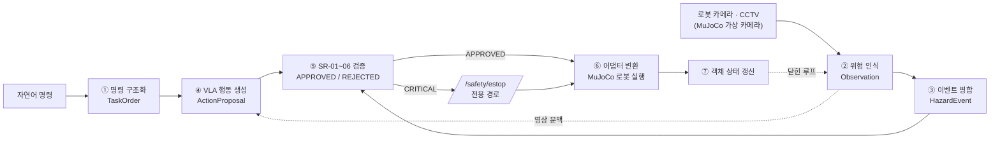
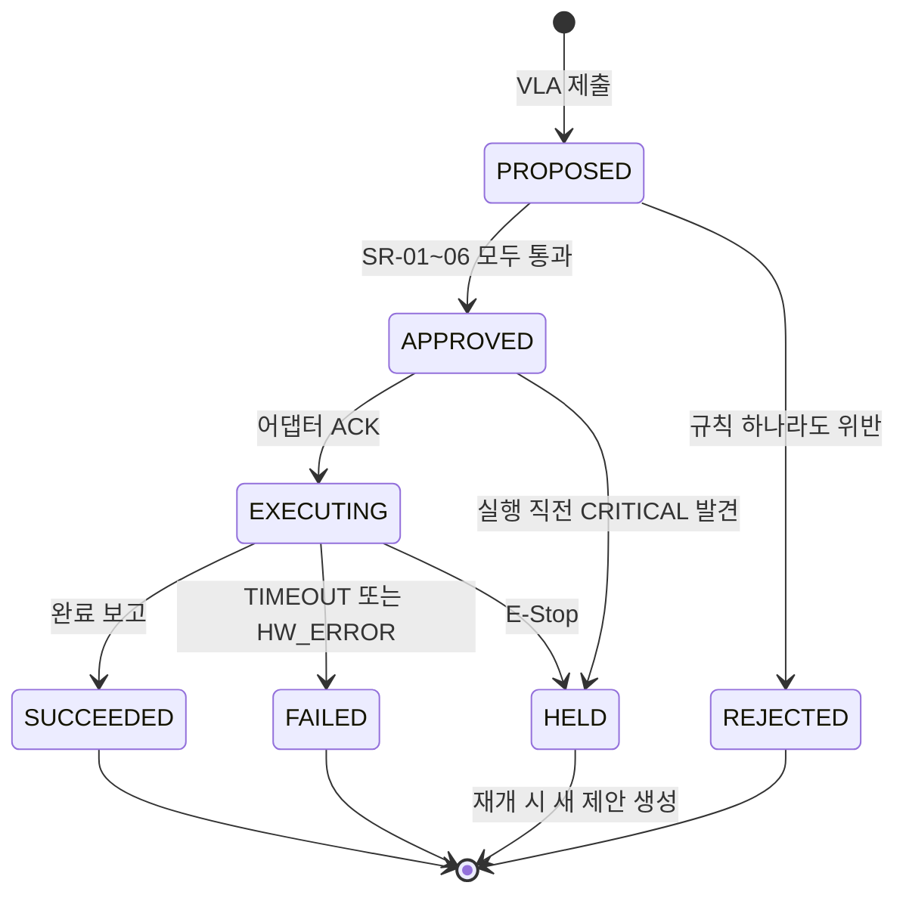

# 온톨로지 기반 안전 중심 VLA 로봇 제어 시스템 — 개발계획서 v1.0 (실행판)

| 항목 | 내용 |
|---|---|
| 문서 버전 | v1.0 — v0.1 초안을 전면 재작성한 실행 기준 문서. 착수에 필요한 수치·규칙·인터페이스를 본문에 확정 수록 |
| 개정 | 2026-10-11 — 시뮬레이터를 NVIDIA Isaac Sim에서 MuJoCo로 변경 (아래 "개정 이력" 참조) |
| 개발 기간 / 인원 | 16주 / 4명 (CV·팀장, NLP·VLA, Ontology, Control) |
| 개발 목표 | 이기종 로봇과 복수 영상 센서를 공통 온톨로지로 연결하고, VLA가 제안한 행동을 안전 규칙으로 검증한 뒤 승인된 행동만 실행하는 MVP 개발 |
| 스키마 기준선 | [ontology-schema-v1.1.md](ontology-schema-v1.1.md) — 본 문서의 객체명·열거값·규칙 파라미터는 스키마 v1.1과 1:1 정합 (심각도 WARNING/CRITICAL 2등급, 조작은 MANIPULATE + parameters) |
| 문서 통제 | 본 문서와 스키마의 변경은 GitHub 이슈 제안 → 영향 파트 전원 승인 → 버전 태그 후 반영. 4주 차(M1) 이후 스키마 필수 필드 변경은 금지 |

## 개정 이력

| 일자 | 변경 내용 | 영향 범위 |
|---|---|---|
| 2026-10-11 | 시뮬레이션 환경을 NVIDIA Isaac Sim → MuJoCo 3.15.0으로 변경. 스키마·안전 규칙·KPI 수치는 변경 없음 | 3-3, 7, 10, 11, 12, 13장 |
| 2026-10-11 | GPU 판단 기준에서 시뮬레이터 VRAM 항목 제외(MuJoCo는 CPU 기반), 운영 OS에 macOS(Apple Silicon) 추가 | 7장 |
| 2026-10-11 | 위험 항목 "합성 영상 사실성 한계" 추가 | 13장 |

## 1. 개발 배경과 필요성

VLA(Vision-Language-Action) 모델은 영상과 자연어 명령을 바탕으로 로봇 행동을 생성할 수 있지만, 생성 결과가 항상 현장의 안전 규칙과 로봇의 물리적 제약을 만족한다고 보장하기 어렵다. 특히 휴머노이드, 사족로봇 등 로봇의 형태와 제어 인터페이스가 달라지면 같은 명령도 로봇별로 다르게 실행해야 한다.

또한 로봇에 장착된 카메라만으로는 가림이나 제한된 시야 때문에 작업자 접근과 위험 상황을 놓칠 수 있다. 따라서 로봇 영상뿐 아니라 고정형 CCTV와 드론 영상까지 공통 형식으로 수집하고, 여러 시점에서 관측된 정보를 하나의 위험 이벤트로 통합할 필요가 있다.

본 과제에서는 AI가 생성한 행동을 바로 실행하지 않고 `ActionProposal`로 제출하게 한다. 온톨로지 기반 안전 검증 계층은 로봇 상태, 작업자 위치, 금지구역, 위험 이벤트, 그리고 관측 공백 여부까지 확인해 행동을 승인 또는 거부한다. 승인된 행동만 로봇별 ROS 2 제어 어댑터를 통해 실행하며, 모든 판단은 감사 로그로 남는다.

## 2. 최종 개발 목표

1. 자연어 명령과 영상 입력을 이용해 로봇 행동 제안을 생성한다.
2. 로봇 탑재 카메라와 고정형 CCTV 영상을 수집해 작업자와 위험 요소를 인식한다.
3. 서로 다른 영상에서 발생한 탐지 결과를 시간과 위치 기준으로 통합해 `HazardEvent`를 생성한다.
4. VLA의 행동 제안을 온톨로지 안전 규칙(SR-01~06)으로 검증한다.
5. 승인된 행동만 ROS 2 기반 제어 어댑터를 통해 실행한다.
6. 휴머노이드와 사족로봇 등 서로 다른 로봇을 같은 Action 인터페이스로 제어할 수 있는 구조를 설계한다.
7. 행동 제안, 승인, 거부, 정지, 재개, 실행 결과를 감사 로그로 기록한다.

## 3. 개발 범위

### 3-1. 핵심 MVP 범위

- 자연어 명령의 `TaskOrder` 변환, VLA 출력의 `ActionProposal` 변환
- 로봇 탑재 카메라와 고정형 CCTV 영상 수집(시간 동기화 포함), VLM 기반 작업자·위험 요소 탐지
- 복수 영상 탐지 결과의 `HazardEvent` 통합(수치화된 병합·해제 규칙)
- 온톨로지 객체·관계 정의(스키마 v1.1)와 안전 규칙 SR-01~06 구현
- 승인, 거부, 비상정지(전용 경로), 작업 재개(2단계) 흐름 구현
- ROS 2 공통 Action 인터페이스와 최소 1종 로봇 통합 시연, 추가 로봇용 어댑터 구조 검증(Mock 어댑터 포함)
- 정상 실행 및 위험 개입 시나리오 시연, 감사 로그와 상태 변화 기록

### 3-2. 시간 여유 시 확장 범위

- 드론 영상 스트림 연동, 휴머노이드·사족로봇 2종의 실제 또는 시뮬레이션 제어 비교
- 여러 로봇 동시 작업의 이벤트 관리, 카메라 간 좌표 변환 기반 동일 객체 추적, 이벤트 우선순위·중복 병합 고도화

### 3-3. 범위 판정 원칙 (실행 기준)

- 확장 범위는 12주 차 통합 게이트(M3, 10장) 통과 후에만 착수한다. M3 미통과 시 확장 범위는 전면 보류하고 핵심 시나리오 안정화에 집중한다.
- 최소 시연 구성: **MuJoCo** 내 매니퓰레이터 탑재 모바일 로봇(또는 사족로봇) 1종 + 고정형 CCTV 2대(MuJoCo 장면 내 가상 카메라). 로봇 모델은 MuJoCo Menagerie 등 공개 MJCF 모델을 우선 사용한다. 시나리오 C(이기종 전환)는 두 번째 어댑터를 Mock 노드로 검증하는 것을 최소 합격선으로 한다.

## 4. 시스템 구성

데이터는 다음 순서로 흐르며, 각 단계의 산출물은 모두 온톨로지 객체로 기록된다.

| 단계 | 입력 | 처리 | 산출 (온톨로지 객체) |
|---|---|---|---|
| ① | 자연어 명령 | 명령 구조화 (NLP) | `TaskOrder` |
| ② | 로봇 카메라·CCTV(·드론) 프레임 | VLM/경량 탐지기 인식 | `Observation` |
| ③ | 복수 Observation | 시간·공간 병합 (Fail-Closed) | `HazardEvent` |
| ④ | TaskOrder + 영상 문맥 | VLA 행동 생성 | `ActionProposal` (PROPOSED) |
| ⑤ | ActionProposal | SR-01~06 검증 | APPROVED / REJECTED + `ExecutionLog` |
| ⑥ | 승인 Action | 공통 Action 발행 → 어댑터 변환 | 로봇 실행 + 결과 `ExecutionLog` |
| ⑦ | 실행·센서 상태 | 객체 속성 실시간 갱신 | 다음 추론(②~⑤)의 입력 (닫힌 루프) |

※ 비상정지(E-Stop)는 위 파이프라인과 별도의 전용 경로로 발행된다 — 5-6장

## 5. 주요 모듈 (실행 명세)

### 5-1. 영상 수집 모듈

- **공통 프레임 규격**: `source_id`, `robot_id`(탑재형), `timestamp`(촬영), `ingested_at`(도착), `frame_id`, 카메라 pose — 촬영/도착 이중 타임스탬프로 지연을 측정한다(스키마 Observation 선택 필드와 동일)
- **시간 동기화**: 전 노드 chrony(NTP) 동기, 오프셋 ±10ms 이내 주기 점검. 이벤트 비교는 촬영 시각 기준. MuJoCo 가상 카메라는 시뮬레이션 시각을 촬영 시각으로 기록한다.
- **재정렬 버퍼**: 수집기당 200ms 지터 버퍼로 순서 재정렬, 500ms 초과 지연 프레임은 폐기 후 드롭 카운터 기록
- **스트림 하트비트**: 2초 무수신 시 해당 Sensor를 `DEGRADED`로 전환 — SR-06(관측 공백) 판단에 반영. Sensor에는 `covered_zone_ids`를 등록해 어느 구역을 커버하는지 명시한다

### 5-2. VLM 기반 인식 모듈

- **출력 계약(Observation)**: `detected_type`(WORKER/ROBOT/OBJECT/FIRE/SMOKE/OBSTACLE), `position` + `position_source`(WORLD/ZONE_MAPPED/IMAGE_ONLY), `confidence`, source·시각 — 모델 교체와 무관하게 이 구조를 유지
- **클래스별 신뢰도 임계**: WORKER 0.5, FIRE·SMOKE 0.4 (안전 우선으로 낮게 설정), 나머지 0.6
- **추론 주기 예산**: 위험 인식 경로 프레임당 100ms 이내(10Hz). 입력 640px·배치 1로 시작하고, 8주 차 실측이 7Hz 미만이면 위험 클래스 전용 경량 탐지기(YOLO 계열)로 전환하며 VLM은 저주기 보조로 강등한다(사전 정의된 강등 규칙)
- 학습은 사전학습 백본 우선. 8주 차(M2) WORKER 재현율 80% 미만일 때만 탐지 헤드 학습·LoRA에 착수하고, 원본·라벨·버전·평가를 함께 관리한다(초안 8장을 수치 기준으로 통합)

### 5-3. 복합 이벤트 관리 모듈

| 항목 | 규칙 (스키마 v1.1 6장과 동일) |
|---|---|
| 병합 조건 | 동일 `hazard_type` AND 촬영 시각 차 ≤ 1.0초 AND (두 관측 모두 WORLD 좌표이면 거리 ≤ 1.5m, 그 외 동일 `zone_id`) → 기존 HazardEvent에 관측 추가 |
| 신뢰도·출처 | `confidence` = 관측 최대치, `source_observation_ids` 합집합. 서로 다른 센서 2개 이상 확인 시 심각도 상향 검토 |
| 심각도 (2등급) | WARNING(경고 반경 접근, 저신뢰 단일 관측 등) / CRITICAL(금지구역 진입, 화재·연기, `estop_distance` 이내 접근) — CRITICAL만 E-Stop 트리거 |
| 유지·해제 | 마지막 관측 후 3초 유지(`last_observed_at` 기준). WARNING은 전 소스 15프레임 연속 미탐지 시 자동 해제(`resolved_by=SENSOR_AUTO`), CRITICAL은 관리자 `ResolveHazard`로만 해제 |
| 충돌 시 원칙 | Fail-Closed: 한 소스가 CRITICAL을 탐지하면 타 소스의 미탐지와 무관하게 위험 상태 유지 |

### 5-4. 온톨로지 및 안전 검증 모듈

현장 상태는 스키마 v1.1의 객체 11종(Robot, Sensor, Observation, Worker, PhysicalObject, Zone, TaskOrder, ActionProposal, SafetyRule, HazardEvent, ExecutionLog)으로 관리한다. ActionProposal 제출 시 아래 안전 규칙을 검사하며, 파라미터는 Zone·Robot 속성으로 관리해 코드 수정 없이 조정한다.

| 규칙 ID | 검사 항목 | 조건식 (기본 파라미터) | 위반 시 조치 (`on_violation`) |
|---|---|---|---|
| SR-01 | 속도 제한 | `speed_limit ≤ min(robot.motion_limits, zone.max_speed)` — 기본 0.4 m/s | REJECT |
| SR-02 | 금지구역 | 예상 경로(직선 보간)와 KEEP_OUT Zone 경계 교차 없음 | REJECT / 실행 중 위반 시 ESTOP |
| SR-03 | 작업자 안전거리 | 전 Worker 최소 거리 ≥ `zone.minimum_safety_distance`(1.2m) | REJECT |
| SR-03E | 비상정지 반경 | 전 Worker 최소 거리 ≥ `zone.estop_distance`(0.6m) | 즉시 ESTOP |
| SR-04 | 활성 위험 | 대상 로봇·구역에 OPEN 상태 CRITICAL HazardEvent 없음 | REJECT + Hold State |
| SR-05 | 로봇 상태 | `robot.status`가 IDLE 또는 재계획 가능한 HOLD (ERROR·저전압 아님) | REJECT |
| SR-06 | 관측 공백 | 작업 구역을 COVERS하는 ONLINE Sensor ≥ 1 | REJECT (Fail-Closed) |

**ActionProposal 상태머신** — 전 전이는 근거(통과/위반 규칙 ID, 판정 소요 `evaluated_in_ms`)와 함께 ExecutionLog에 기록된다.

[그림 1] ActionProposal 상태 전이도 (스키마 status와 동일: SUCCEEDED/FAILED는 DONE의 세분)

### 5-5. 이기종 로봇 제어 어댑터

상위 시스템은 로봇 종류와 무관하게 스키마 v1.1의 `action_type` 4종을 사용한다. 조작 세부(집기·놓기)는 별도 열거값이 아니라 `MANIPULATE`의 `parameters`로 표현한다.

| action_type | parameters (필수) | 어댑터 변환 예 |
|---|---|---|
| `MOVE_TO` | `target_pose`, `speed_limit` | 사족로봇: Nav2 goal·보행 모드 / 휴머노이드: 보행 목표 / 바퀴 로봇: `/cmd_vel` |
| `MANIPULATE` | `manipulation: PICK\|PLACE`, `object_id`, `target_pose` | 매니퓰레이터 MoveIt 궤적 또는 관절·말단 자세 명령 (미지원 로봇은 `UNSUPPORTED` 응답) |
| `STOP` | (없음) | 작업 취소·안전 자세 — 전 어댑터 필수 구현 |
| `RESUME` | `task_id` | Hold 해제 후 대기 상태 복귀 |

- **공통 규약**: 수신 즉시 ACK, 완료·실패 시 result(성공 여부, 사유 코드 `UNSUPPORTED`/`TIMEOUT`/`HW_ERROR`) 보고. 미지원 조합은 실행 거부가 아닌 `UNSUPPORTED` 응답으로 상위가 재계획
- 어댑터 수준 정지(HOLD)는 ActionProposal이 아니라 5-6장의 E-Stop 전용 경로로 전달되는 제어 신호이다(스키마 v1.1 용어 정합)
- **적합성 시험**: HOLD 신호 수신→정지 지연 측정, 미승인 Action 직접 주입 시 거부 확인 — 신규 어댑터는 통과 후 통합
- **MuJoCo 연동**: MuJoCo는 ROS 2 브리지를 기본 제공하지 않으므로, 시뮬레이션 로봇과 ROS 2 토픽(`/cmd_vel`, `/odom` 등)을 잇는 브리지 노드를 Control 파트가 구현해 어댑터 아래에 둔다. 상위 계층과 어댑터 인터페이스는 시뮬레이터와 무관하게 유지한다.

### 5-6. E-Stop 전용 경로

- **경로 분리**: E-Stop은 검증 서버 API를 경유하지 않는 ROS 2 전용 latched 토픽(`/safety/estop`, Reliable QoS)으로 발행 — 서버 장애 시에도 정지 보장
- **삼중 트리거**: 규칙 엔진(SR-03E·SR-04) / 운영자 수동 / 하트비트 손실 — 발원지는 `ExecutionLog.triggered_by`로 기록
- **하트비트**: 검증 서버→어댑터 5Hz. 1초(5주기) 무수신 시 어댑터가 자율적으로 HOLD 진입 (Fail-Closed)
- **복귀 2단계**: 관련 CRITICAL HazardEvent의 `ResolveHazard`(관리자) 승인 → `RESUME` 승인. 기존 제안은 재사용하지 않고 신규 ActionProposal로 재검증

## 6. 기능 요구사항

| ID | 기능 | 구현 내용 | 확인 방법 (합격 기준) |
|---|---|---|---|
| FR-01 | 명령 구조화 | 자연어 명령을 TaskOrder로 변환 | 생성 객체 필수 필드 검사 |
| FR-02 | 행동 제안 | VLA 출력을 ActionProposal(PROPOSED)로 저장, 실행 권한 없음 | 제안-원본 출력 비교, 직접 실행 경로 부재 확인 |
| FR-03 | 다중 영상 수집 | 로봇·CCTV 스트림에 이중 타임스탬프·출처 부여, ±10ms 동기 | 동시 스트림 수집 + 동기 오차 실측 |
| FR-04 | 위험 인식 | 작업자·위험 요소를 Observation 구조로 변환 | 시험 영상 재현율 (WORKER ≥ 80%) |
| FR-05 | 이벤트 통합 | 복수 영상 중복 탐지를 병합 규칙(5-3)으로 단일 HazardEvent화 | 동시 관측 20회 병합률 ≥ 90% |
| FR-06 | 안전 검증 | SR-01~06으로 승인/거부, 근거를 ExecutionLog에 기록 | 위반 Proposal 100건 주입 전 건 거부 |
| FR-07 | 정지·재개 | CRITICAL 시 E-Stop 전용 경로 + Hold, 2단계 복귀 | 위험 주입 30회 전 건 정지, 복귀 절차 로그 |
| FR-08 | 이기종 제어 | 공통 Action을 어댑터가 로봇별 ROS 2 명령으로 변환 | 어댑터 교체(코드 무수정) 시나리오 C 통과 |
| FR-09 | 감사 추적 | 제안~실행 전 단계 판단 근거·소요시간 기록 | 필수 필드 누락 0건 (검사 스크립트) |
| FR-10 | 관측 공백 차단 | 커버 센서 부재·DEGRADED 시 이동 제안 거부 (신설) | 센서 차단 시험에서 제안 거부 확인 |

## 7. 개발 환경과 기술 스택

- **운영체제·미들웨어**: Ubuntu 22.04 LTS 또는 macOS(Apple Silicon), 로봇 미들웨어 ROS 2 Humble. ROS 2·MuJoCo·빌드 도구는 pixi(RoboStack) 환경으로 버전을 고정해 두 OS에서 동일하게 구성한다.
- **시뮬레이션**: MuJoCo 3.15.0 — 로봇(MJCF 모델), 작업자 모형, 금지구역 표시, 가상 CCTV 카메라를 장면에 배치하고, ROS 2 브리지 노드로 제어·상태 토픽과 연결한다.
- **AI**: Python, PyTorch, OpenCV — VLA 백본 OpenVLA 계열, VLM 백본 Florence-2·LLaVA 계열 + 경량 객체 탐지 모델(강등 경로)
- **온톨로지·API**: FastAPI, JSON 스키마(v1.1), 상태 전달·캐시 Redis 또는 ROS 2 메시지, 협업 GitHub 이슈·코드 리뷰
- **GPU 판단 기준(실행 규칙)**: 2주 차에 AI용 GPU 실측 — VRAM 24GB 미만이거나 VLM(≈8GB)·VLA(≈10GB) 동시 구동 불가 시, AI 추론 서버와 시뮬 PC를 네트워크로 분리(ROS 2/API 연결)하는 2안을 채택하고 모델·배치 크기를 그에 맞춰 확정한다. MuJoCo 물리 연산은 CPU에서 동작하므로 시뮬레이터는 GPU VRAM 예산에 포함하지 않는다.
  - 2026-10-09 현황: MuJoCo 장면은 로컬 PC(macOS)에서 실행하고, Florence-2 추론은 GPU 서버(DIS06, RTX A6000 48GB)에서 수행해 2안 형태로 운용 중이다.

## 8. 검증 시나리오와 합격 기준

| 시나리오 | 절차 | 합격 기준 |
|---|---|---|
| A. 정상 작업 | 명령 입력 → TaskOrder·Proposal 생성 → SR 검사 통과 → 어댑터 실행 → 결과 기록 | 10회 연속 성공률 ≥ 90%, 명령→실행 개시 ≤ 1s |
| B. CCTV 위험 개입 | 작업 중 CCTV가 금지구역 진입 탐지 → HazardEvent(CRITICAL) 병합 생성 → 추가 행동 거부 + E-Stop → 해제 후 2단계 재개 | 위험 주입 30회 전 건 차단, E-Stop 발행 ≤ 100ms 로그 제출 |
| C. 이기종 전환 | 동일 TaskOrder·공통 Action 유지, 어댑터만 휴머노이드↔사족로봇 (Mock 허용) 교체 | 상위 코드 무수정, 교체 30분 이내, 동일 명령 수행 확인 |
| D. 드론 연동 (확장) | 드론 영상 원거리 탐지를 CCTV·로봇 관측과 병합, 승인·정지 판단 반영 | M3 통과 시에만 착수, 병합 규칙 재사용 |

## 9. 평가 지표 (확정)

| No | 지표 | 목표 | 측정 절차 (합격 기준) |
|---|---|---|---|
| 1 | 위험 인식 주기 | ≥ 10 Hz | 1분 연속 구동 평균 (p95 ≥ 7Hz) |
| 2 | CRITICAL 이벤트 → E-Stop 발행 지연 | ≤ 100 ms | 위험 주입 30회 타임스탬프 차 전 건 |
| 3 | Proposal 제출 → 판정 지연 | ≤ 50 ms | 1,000건 `evaluated_in_ms`의 p95 |
| 4 | 미승인 Action의 ROS 2 전달 | 0 건 | 위험 30회 + 위반 Proposal 100건 주입 |
| 5 | 동일 사건 HazardEvent 병합률 | ≥ 90% | 2카메라 동시 관측 20회 |
| 6 | 가림 상황 탐지 재현율 향상 | +20 %p | 로봇 카메라 가림 시 CCTV 병행 비교 |
| 7 | 이기종 어댑터 교체 | 코드 무수정·30분 | 시나리오 C 교체 시험 |
| 8 | 감사 로그 완전성 | 누락 0건 | 전 구간 ExecutionLog 필수 필드 검사 |
| 9 | 명령 → 실행 개시 (E2E) | ≤ 1 s | 시나리오 A 10회 명령~어댑터 ACK |

※ 전 지표는 감사 로그·측정 스크립트만으로 산출한다(스키마 v1.1의 `ingested_at`·`evaluated_in_ms` 활용). 4주 차 KPI 리뷰에서 장비 실측에 근거해 지표 1·6 수치만 재조정 가능하며, 안전 핵심 지표 2·4·8은 하향 조정 불가로 고정

## 10. 16주 개발 일정 (담당·완료 기준·게이트)

| 기간 | 주요 작업 | 담당 | 완료 기준 (DoD) |
|---|---|---|---|
| 1~2주 | 요구분석, 로봇·센서 후보, GPU 실측, 범위 확정 | 전원 | 요구명세 v1 리뷰 승인, GPU 1안/2안 결정 |
| 3~4주 | 스키마 v1.1 검토·동결, OpenAPI·공통 인터페이스 | Ontology 주도 | 스키마 동결(M1), API 초안, KPI 리뷰 |
| 5~6주 | ROS 2·MuJoCo 환경(브리지 노드 포함), 어댑터 기본 구조 | Control | Mock 어댑터 MOVE_TO·HOLD 왕복 데모 |
| 7~8주 | 다중 영상 수집·동기화, VLM 위험 인식 | CV | 2스트림 동시 수집 + WORKER 탐지 데모(M2), 재현율 예비측정 |
| 9~10주 | 이벤트 통합, SR-01~06·E-Stop 경로 구현 | CV·Ontology | 위험 주입 10회 예비 시험 차단 10/10 |
| 11~12주 | VLA 제안·검증·실행 통합 | NLP·전원 | 시나리오 A E2E 성공(M3), KPI 2·3·4 예비 달성 |
| 13~14주 | 시나리오 반복 시험, 이기종 어댑터 검증 | 전원 | KPI 1~9 본측정 1차, 시나리오 C 통과 |
| 15주 | 선택 확장(드론), 성능 측정, 결과 정리 | 전원 | KPI 최종 측정표·로그·영상 확보 |
| 16주 | 최종 시연, 기술문서, 논문 초안 | 전원 | MVP 시연(M4), 문서·논문 초안 제출 |

- **게이트 원칙**: M1(4주, 스키마 동결) 미통과 시 5주 차를 스키마 확정에 재투입. M3(12주, E2E 통합) 미통과 시 확장 범위 전면 보류(3-3장). 게이트 판정은 주간 멘토 회의에서 수행
- **문서·스키마 변경 절차**: GitHub 이슈 제안 → 영향 파트 전원 승인 → 버전 태그(v1.x) 후 반영. 필수 필드 변경은 v2 제안으로만 취급

## 11. 역할 분담과 협업 방식

| 담당 | 주요 업무 | 담당 지표 |
|---|---|---|
| CV·팀장 | 로봇·CCTV 영상 수집·동기화, VLM 위험 인식, 복합 이벤트 관리 | KPI 1·5·6 |
| NLP·VLA | 자연어 명령 파싱, TaskOrder·ActionProposal 생성 | KPI 9 |
| Ontology | 객체·관계·Action 스키마, SR 규칙·E-Stop 경로, 감사 로그 | KPI 2·3·4·8 |
| Control | ROS 2, MuJoCo(장면·ROS 2 브리지), 이기종 어댑터·적합성 시험, 시험 하네스 | KPI 7, 실증 |

- 주 1회 멘토 포함 Zoom 회의(진행·리스크·게이트 판정), 주 1회 팀원 대면 회의(개발·통합·테스트), GitHub 이슈·마일스톤으로 담당자와 완료 기준 기록

## 12. 예상 산출물

- 온톨로지 스키마 v1.1(객체·관계·Action)과 변경 이력, OpenAPI 명세
- 다중 영상 수집·위험 이벤트 통합 모듈, 안전 Action 검증 서버, E-Stop 전용 경로
- ROS 2 공통 Action 인터페이스·로봇별 어댑터·적합성 시험 절차서
- MuJoCo 기반 시나리오 A~C 자동 시험 하네스(장면 MJCF·ROS 2 브리지 포함), KPI 측정 스크립트와 원시 로그
- 감사 로그·시험 결과 보고서, 설치·실행·API 기술문서, 논문 초안·학술 발표 자료

## 13. 예상 위험과 대응 (확률·영향·트리거)

| 위험 | 확률 | 영향 | 조기 트리거 | 대응 |
|---|---|---|---|---|
| 로봇별 제어 차이가 큼 | 중 | 중 | 5~6주 Mock 어댑터 시험 | 공통 Action 최소 유지, 차이는 어댑터 내부 + UNSUPPORTED 규약 |
| 복수 영상 시간·좌표 불일치 | 고 | 고 | 7주 2스트림 동기 오차 실측 | 타임스탬프 + zone 매핑 우선, WORLD 좌표는 단계 적용(`position_source`) |
| VLM 추론 속도 부족 | 중 | 고 | 8주(M2) 실측 < 7Hz | 해상도·주기 조정, 경량 탐지기 강등 규칙(5-2) |
| 실제 로봇 확보 지연 | 고 | 중 | 6주까지 장비 미확정 | MuJoCo + Mock 어댑터로 전 KPI 성립 |
| GPU 자원 부족 | 중 | 중 | 2주 실측 VRAM < 24GB | AI/시뮬 분리 2안(7장), 모델 경량화 |
| 합성 영상 사실성 한계 (신설) | 중 | 중 | 8주 재현율 측정 시 MuJoCo 영상과 실영상 결과 차이 | MuJoCo 영상은 파이프라인·통합 시험용으로 쓰고, 인식 성능(FR-04·KPI 1·6)은 공개 실영상 데이터로 별도 평가 |
| 범위 확대(드론 등) | 중 | 중 | M3 미통과 | 확장 전면 보류 규칙(3-3) |
| 데이터 부족·개인정보 | 중 | 중 | 8주 재현율 < 80% | 합성·공개 데이터 우선, CCTV 얼굴 비식별화 후 저장 |

## 부록 A. 인터페이스 명세 초안

아래 표는 모듈 간 목표 인터페이스다. 현재 FastAPI MVP의 실제 경로, 요청·응답과 미구현 범위는 [Backend API 명세 v0.2](backend-api-spec-v0.2.md)를 기준으로 하며, 현재 버전에는 `/api/v1` prefix가 없다.

| 엔드포인트 / 토픽 | 방식 | 용도 |
|---|---|---|
| `POST /api/v1/proposals` | REST | ActionProposal 제출 → 판정 결과(+규칙 ID, `evaluated_in_ms`) 응답 |
| `GET /api/v1/objects/{type}` | REST | 온톨로지 객체 조회 |
| `POST /api/v1/hazards/{id}/resolve` | REST | ResolveHazard (CRITICAL은 관리자 권한) |
| `POST /api/v1/tasks/{id}/resume` | REST | ResumeTask 2단계 복귀 |
| `WS /ws/state` | WebSocket | 객체 상태·이벤트 실시간 구독 |
| `/safety/approved_action` | ROS 2 topic | 승인된 공통 Action 발행 |
| `/safety/estop` | ROS 2 topic (latched) | E-Stop 전용 경로 (5-6장) |
| `/safety/heartbeat` | ROS 2 topic (5Hz) | 검증 서버 생존 신호 — 손실 시 어댑터 자율 HOLD |
| `/adapter/{robot_id}/result` | ROS 2 topic | 어댑터 ACK·실행 결과 보고 |

※ 본 표는 모듈 간 경계 합의용 기준선이다. 상세 요청·응답은 구현 명세와 FastAPI `/openapi.json`에서 관리하고, 목표 경로로 전환할 때 같은 PR에서 두 문서를 갱신한다.
