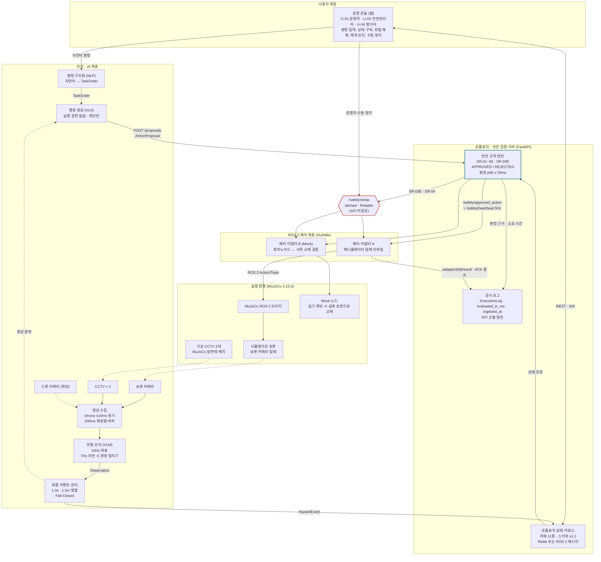
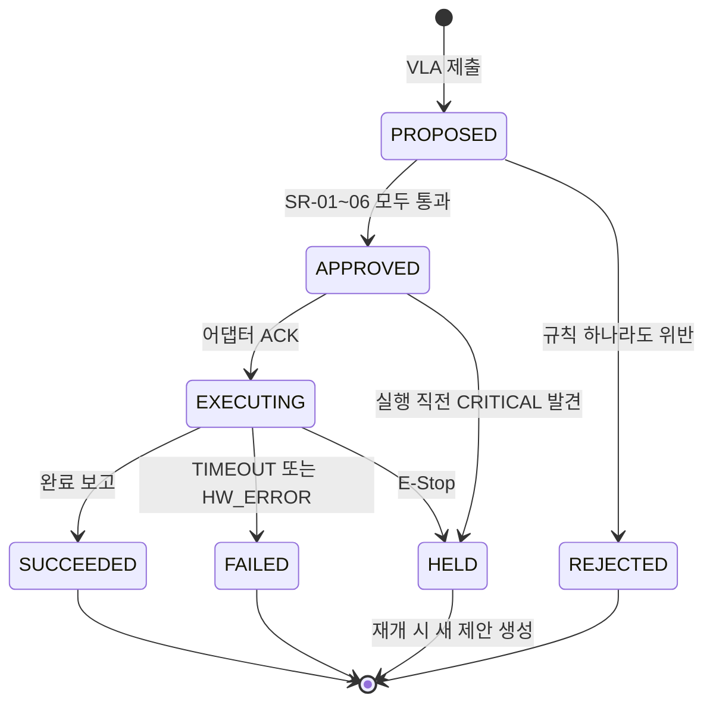
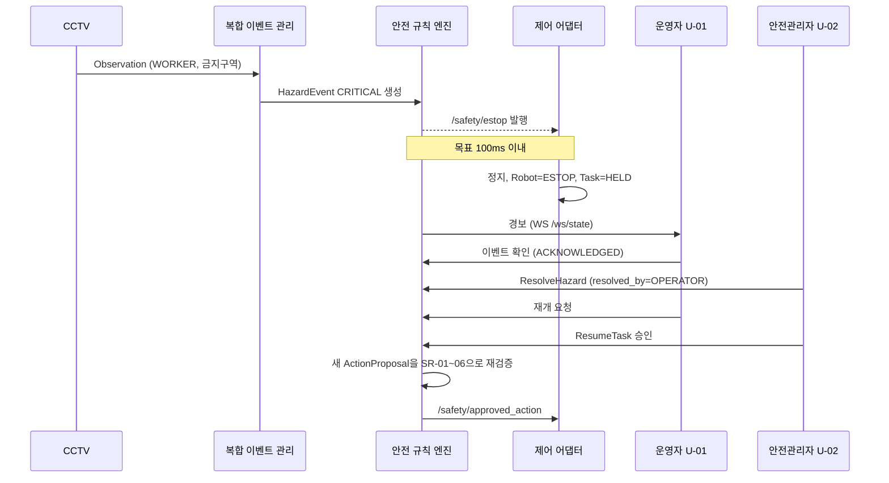
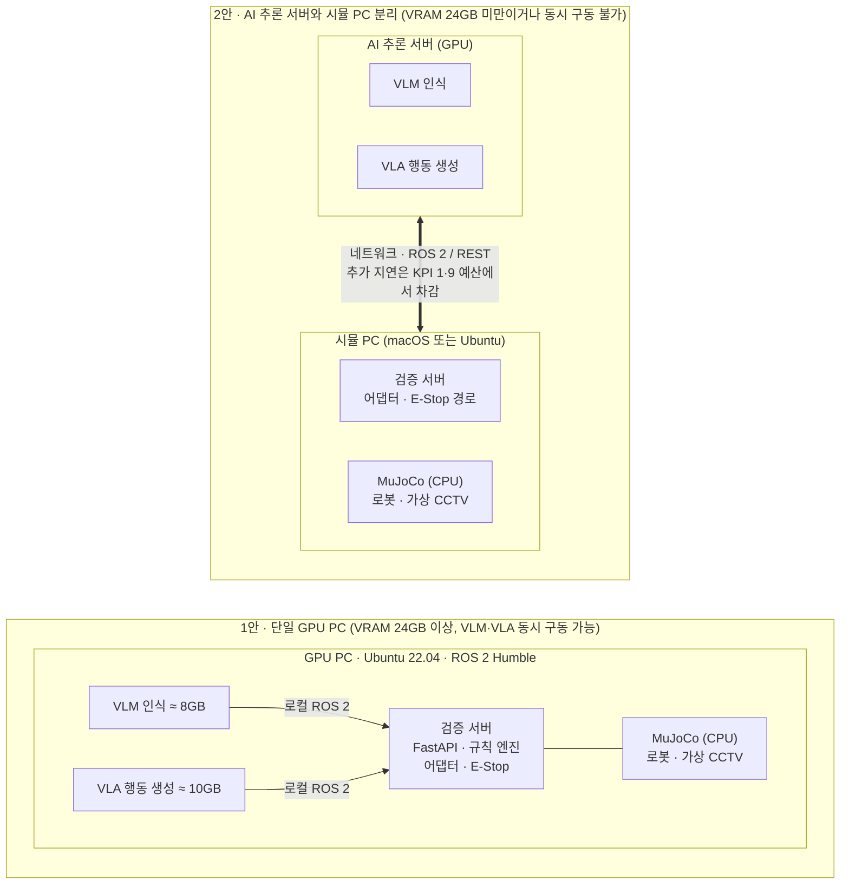

# 온톨로지 기반 안전 중심 VLA 로봇 제어 시스템 — 사용자 정의서 및 시스템 구조도 보고서

산학 과제 · 실행 문서

| 항목 | 내용 |
|---|---|
| 문서 버전 | v0.1 초안 |
| 작성일 | 2026-09-29 (2026-10-11 MuJoCo 반영 개정) |
| 근거 문서 | [개발계획서 v1.0](개발계획서_v1.0_실행판.md) · [스키마 v1.1](ontology-schema-v1.1.md) |
| 적용 범위 | MuJoCo 기반 MVP (16주) |

개발계획서 v1.0(실행판)과 온톨로지 스키마 v1.1을 근거로, 누가 시스템을 쓰고 무엇을 할 수 있는지(1부)와 시스템이 어떻게 구성되고 연결되는지(2부)를 정리한 착수용 기준 문서입니다.

> **2026-10-11 개정**: 시뮬레이터를 NVIDIA Isaac Sim에서 MuJoCo로 변경했습니다. 사용자·권한·유스케이스는 바뀌지 않았고, 7장 구조도의 실행 환경 계층, 10장 배포 구성, 12장 확인 사항의 시뮬레이터 표기를 수정했습니다. 원본의 그림은 Mermaid 도식으로 다시 그렸습니다.

## 목차

- [작성 전제](#작성-전제)
- 제1부 사용자 정의서
  - [1. 사용자 분류](#1-사용자-분류)
  - [2. 권한 매트릭스](#2-권한-매트릭스)
  - [3. 유스케이스 목록](#3-유스케이스-목록)
  - [4. 핵심 유스케이스 명세](#4-핵심-유스케이스-명세)
  - [5. 사용자 요구사항](#5-사용자-요구사항)
  - [6. 운영 콘솔 최소 화면 (제안)](#6-운영-콘솔-최소-화면-제안)
- 제2부 시스템 구조도
  - [7. 전체 시스템 구조](#7-전체-시스템-구조)
  - [8. ActionProposal 상태 전이](#8-actionproposal-상태-전이)
  - [9. 위험 개입과 재개 흐름 (시나리오 B)](#9-위험-개입과-재개-흐름-시나리오-b)
  - [10. 배포 구성 (2주 차 GPU 실측으로 결정)](#10-배포-구성-2주-차-gpu-실측으로-결정)
  - [11. 모듈 책임과 인터페이스](#11-모듈-책임과-인터페이스)
  - [12. 확인이 필요한 사항](#12-확인이-필요한-사항)

## 작성 전제

계획서에 명시되지 않아 이 보고서에서 정한 사항입니다. 12장에서 확인을 요청합니다.

- 계획서는 REST·WebSocket API만 정의하고 사용자 화면은 정의하지 않습니다. 이 문서는 사람이 쓰는 운영 콘솔(웹)이 있다고 가정했습니다.
- 스키마의 `OPERATOR` 값을 작업 운영자와 안전 관리자 두 역할로 나눴습니다. CRITICAL 해제와 재개 승인은 계획서가 "관리자 권한"으로 명시한 기능이므로 안전 관리자에게만 줍니다.
- 객체명·열거값·수치는 스키마 v1.1과 계획서 v1.0을 그대로 썼습니다. 새로 만든 것은 사용자 ID(U-), 유스케이스 ID(UC-), 사용자 요구사항 ID(UR-)뿐입니다.

---

# 제1부 사용자 정의서

## 1. 사용자 분류

시스템을 직접 조작하는 사람 4종, 조작하지 않지만 보호 대상인 사람 1종, 그리고 사람 대신 행동하는 시스템 액터로 나눕니다.

| ID | 사용자 | 하는 일 | 시스템 접점 | 스키마 대응 |
|---|---|---|---|---|
| U-01 | 작업 운영자 | 자연어로 작업을 지시하고, 진행과 판정 결과를 지켜보며, 이상 시 수동 비상정지를 누른다. | 운영 콘솔, `WS /ws/state` | `triggered_by=OPERATOR` |
| U-02 | 안전 관리자 | CRITICAL 위험을 현장 확인 후 해제하고, 작업 재개를 승인하며, 구역별 안전 파라미터를 결정한다. | 운영 콘솔 관리자 메뉴, `POST /hazards/{id}/resolve`, `POST /tasks/{id}/resume` | `resolved_by=OPERATOR` |
| U-03 | 시스템 관리자·통합 개발자 | 로봇·센서·구역을 등록하고 커버 구역을 지정하며, 새 제어 어댑터를 적합성 시험 후 통합한다. 스키마 변경을 제안한다. | 설정 파일·API, ROS 2, GitHub 이슈 | Robot, Sensor, Zone, SafetyRule |
| U-04 | 평가자 (멘토·검증 담당) | 감사 로그로 KPI를 산출하고 M1~M4 게이트를 판정한다. 로봇을 조작하지 않는다. | 로그 조회, KPI 측정 스크립트 | ExecutionLog |
| U-05 | 현장 작업자 (보호 대상) | 시스템을 조작하지 않는다. CCTV와 로봇 카메라에 관측되어 위치와 안전 상태가 추적된다. | 없음 (관측 대상) | Worker, `safety_status` |

| ID | 시스템 액터 | 역할 | 제약 |
|---|---|---|---|
| S-01 | VLA 모델 (OpenVLA 계열) | TaskOrder와 영상 문맥으로 행동을 생성한다. | 실행 권한 없음. 출력은 반드시 ActionProposal(PROPOSED)로 제출한다. |
| S-02 | 인식 모델 (Florence-2·LLaVA 계열, 강등 시 YOLO 계열) | 프레임에서 작업자·위험 요소를 탐지해 Observation을 만든다. | 신뢰도 임계 WORKER 0.5, FIRE·SMOKE 0.4, 그 외 0.6 |
| S-03 | 영상 센서 (로봇 카메라, CCTV 2대, 드론은 확장) | 프레임을 공급한다. MVP에서는 MuJoCo 장면의 가상 카메라가 이 역할을 한다. | 2초 무수신 시 DEGRADED, 커버 구역은 `covered_zone_ids`로 등록 |
| S-04 | 제어 어댑터 | 공통 Action을 로봇별 ROS 2 명령으로 바꾸고 ACK·결과를 보고한다. | 하트비트 1초 손실 시 스스로 HOLD (`triggered_by=HEARTBEAT_LOSS`) |

| 개발 역할 | 개발·시험 중 맡는 사용자 역할 | 책임 KPI |
|---|---|---|
| CV·팀장 | U-03 (센서 등록·커버 구역 지정), 시험 시 U-01 | 1 · 5 · 6 |
| NLP·VLA | 시험 시 U-01 (명령 입력) | 9 |
| Ontology | U-02 대행 (규칙 파라미터·해제 절차), U-03 (스키마) | 2 · 3 · 4 · 8 |
| Control | U-03 (어댑터 통합·적합성 시험) | 7, 실증 |
| 멘토 | U-04 (주간 게이트 판정) | - |

## 2. 권한 매트릭스

● 가능 △ 제한적(요청만 또는 시험 환경만) ○ 조회만 — 불가

| 기능 | 인터페이스 | U-01 운영자 | U-02 안전관리자 | U-03 시스템관리자 | U-04 평가자 |
|---|---|:-:|:-:|:-:|:-:|
| 자연어 작업 지시 | 콘솔 → NLP | ● | ● | △ | — |
| 현장 상태 실시간 조회 | `WS /ws/state` | ● | ● | ● | ○ |
| 판정 결과·거부 사유 조회 | `GET /objects/{type}` | ● | ● | ● | ○ |
| 수동 비상정지 | `/safety/estop` | ● | ● | ● | — |
| 위험 이벤트 확인 (ACKNOWLEDGED) | 콘솔 | ● | ● | — | — |
| WARNING 위험 수동 해제 | `POST /hazards/{id}/resolve` | ● | ● | — | — |
| CRITICAL 위험 해제 | `POST /hazards/{id}/resolve` | — | ● | — | — |
| 작업 재개 | `POST /tasks/{id}/resume` | △ 요청 | ● 승인 | — | — |
| 안전 파라미터 변경 (Zone·Robot 속성) | 설정·API | — | ● 결정 | ● 적용 | — |
| 로봇·센서·구역 등록 | 설정·API | — | ○ | ● | — |
| 제어 어댑터 통합·적합성 시험 | ROS 2 | — | — | ● | ○ |
| 감사 로그 조회·KPI 산출 | 로그·측정 스크립트 | ○ | ● | ● | ● |
| 스키마 변경 제안 | GitHub 이슈 | — | ● | ● | — |
| 미승인 행동을 로봇에 직접 전달 | 어떤 경로도 없음 | — | — | — | — |

마지막 줄은 권한 설정이 아니라 구조로 보장합니다. 어댑터는 `/safety/approved_action` 외의 입력을 거부하며, 이는 어댑터 적합성 시험("미승인 Action 직접 주입 시 거부")으로 확인합니다.

## 3. 유스케이스 목록

| ID | 유스케이스 | 주 액터 | 관련 요구·규칙 | 인터페이스 |
|---|---|---|---|---|
| UC-01 | 자연어로 작업 지시 | U-01 | FR-01, FR-02, KPI 9 | 콘솔 → NLP |
| UC-02 | 행동 제안 자동 검증 | S-01 | FR-02, FR-06, SR-01~06, KPI 3 | `POST /proposals` |
| UC-03 | 현장 상태 모니터링 | U-01, U-02 | FR-03~05, KPI 1 | `WS /ws/state` |
| UC-04 | 거부 사유 확인 후 재지시 | U-01 | FR-06, FR-09 | `GET /objects/ExecutionLog` |
| UC-05 | 비상정지 (자동·수동·하트비트) | S-04, U-01 | FR-07, SR-03E, SR-04, KPI 2 | `/safety/estop` |
| UC-06 | 위험 이벤트 확인·해제 | U-02 | FR-07, 스키마 6장 | `POST /hazards/{id}/resolve` |
| UC-07 | 작업 재개 (2단계) | U-02 | FR-07, 스키마 9장 | `POST /tasks/{id}/resume` |
| UC-08 | 구역별 안전 파라미터 조정 | U-02, U-03 | FR-06, SR-01·03·03E | Zone·Robot 속성 |
| UC-09 | 센서 등록과 커버 구역 지정 | U-03 | FR-03, FR-10, SR-06 | Sensor `covered_zone_ids` |
| UC-10 | 이기종 어댑터 교체·적합성 시험 | U-03 | FR-08, KPI 7, 시나리오 C | ROS 2 어댑터 |
| UC-11 | 감사 로그 조회·KPI 산출 | U-04 | FR-09, KPI 1~9 | 로그·측정 스크립트 |

## 4. 핵심 유스케이스 명세

안전과 직결되는 네 가지를 상세히 적었습니다. 나머지는 목록과 권한 매트릭스로 충분합니다.

### UC-01 자연어로 작업 지시 — 검증 시나리오 A

| 항목 | 내용 |
|---|---|
| 주 액터 | U-01 작업 운영자 (보조: S-01 VLA, S-04 어댑터) |
| 사전 조건 | 대상 로봇 `status=IDLE`, 작업 구역을 커버하는 ONLINE 센서 1개 이상, 하트비트 정상 |
| 합격 기준 | 10회 연속 성공률 90% 이상, 명령 입력부터 어댑터 ACK까지 1초 이내 (KPI 9) |

**기본 흐름**

1. 운영자가 콘솔에 명령을 입력한다. 예: "작업구역 A의 상자를 선반 B로 옮겨".
2. NLP 모듈이 TaskOrder(CREATED)를 만들고 필수 필드를 검사한다.
3. VLA가 행동을 생성해 ActionProposal(PROPOSED)로 제출한다. 예: `MOVE_TO` → `MANIPULATE(manipulation=PICK)`.
4. 규칙 엔진이 SR-01~06을 검사해 APPROVED로 바꾸고 ExecutionLog에 규칙별 결과와 `evaluated_in_ms`를 남긴다.
5. 승인된 공통 Action이 `/safety/approved_action`으로 발행되고, 어댑터가 즉시 ACK를 보낸다.
6. 어댑터가 완료를 보고하면 제안은 SUCCEEDED, 작업은 COMPLETED가 되고 콘솔에 표시된다.

**예외 흐름**

- 필수 필드 누락 또는 로봇 ERROR: 제출 단계에서 거부.
- 규칙 위반: REJECTED, 콘솔에 위반 규칙 ID와 사유 표시 (UC-04로 이어짐).
- 어댑터 `UNSUPPORTED` 응답: 상위가 재계획해 새 제안을 제출.
- `TIMEOUT`·`HW_ERROR`: FAILED, 작업 FAILED.

### UC-05 비상정지 — 검증 시나리오 B

| 항목 | 내용 |
|---|---|
| 트리거 | 세 경로 중 하나. ① 규칙 엔진: CRITICAL HazardEvent(SR-04) 또는 작업자 0.6m 이내 접근(SR-03E) ② 운영자 수동 ③ 하트비트 1초(5주기) 손실 |
| 합격 기준 | 위험 주입 30회 전 건 정지, CRITICAL 발생부터 E-Stop 발행까지 100ms 이내 (KPI 2, 하향 조정 불가) |

**기본 흐름**

1. CCTV가 금지구역에 들어온 작업자를 탐지해 Observation을 만든다.
2. 이벤트 관리가 로봇 카메라 관측과 병합해 HazardEvent(CRITICAL, OPEN)를 만든다.
3. 규칙 엔진이 TriggerEStop을 호출해 검증 서버 API를 거치지 않는 `/safety/estop`(latched, Reliable)으로 신호를 발행한다.
4. 어댑터가 정지하고, 로봇은 ESTOP, 작업은 HELD, 제안은 HELD가 된다.
5. ExecutionLog(`decision=ESTOP`, `triggered_by=RULE_ENGINE`)가 기록되고 콘솔에 경보가 뜬다.
6. 이후 들어오는 새 제안은 SR-04로 모두 거부된다.

**대안 흐름**

- 수동: 운영자가 콘솔의 상시 노출 정지 버튼을 누른다 (`triggered_by=OPERATOR`).
- 서버 장애: 어댑터가 하트비트를 1초간 못 받으면 스스로 HOLD (`triggered_by=HEARTBEAT_LOSS`).

### UC-06 · UC-07 위험 해제와 2단계 재개

| 항목 | 내용 |
|---|---|
| 주 액터 | U-02 안전 관리자 (요청: U-01 운영자) |
| 사전 조건 | 로봇 ESTOP 또는 HOLD, 관련 HazardEvent가 OPEN 또는 ACKNOWLEDGED |
| 사후 조건 | 해제와 재개 두 판단이 모두 ExecutionLog에 남는다. |

**기본 흐름**

1. 운영자가 경보를 확인해 이벤트를 ACKNOWLEDGED로 바꾼다.
2. 안전 관리자가 현장(영상)에서 위험이 사라졌는지 확인한다.
3. 안전 관리자가 해제한다. RESOLVED, `resolved_by=OPERATOR`. CRITICAL은 이 경로로만 해제된다.
4. 운영자가 재개를 요청하고, 안전 관리자가 승인한다.
5. 시스템이 ResumeTask 조건(관련 위험 전부 RESOLVED, 로봇 오류 없음)을 확인한다.
6. 기존 제안은 재사용하지 않고 새 ActionProposal을 만들어 SR-01~06으로 다시 검증한다.

**예외 흐름**

- 다른 OPEN CRITICAL 이벤트가 남아 있음: 재개 거부.
- 작업 구역 커버 센서가 없거나 DEGRADED: SR-06으로 새 제안 거부.
- WARNING은 전 소스 15프레임 연속 미탐지 시 자동 해제될 수 있음 (`SENSOR_AUTO`).

### UC-09 센서 등록과 커버 구역 지정 — FR-10 관측 공백 차단

| 항목 | 내용 |
|---|---|
| 주 액터 | U-03 시스템 관리자 |
| 합격 기준 | 센서 차단 시험에서 제안 거부 확인 |

**기본 흐름**

1. 센서의 `sensor_type`, `source_uri`, `frame_id`, `pose`를 등록한다.
2. 관측 범위가 덮는 Zone을 `covered_zone_ids`로 지정한다.
3. 월드 좌표 변환이 확보되면 `calibrated=true`, 아니면 구역 매핑(`ZONE_MAPPED`)으로만 위치를 표현한다. MuJoCo 가상 카메라는 장면 정의(MJCF)의 카메라 위치·화각으로 외부 파라미터를 얻을 수 있다.
4. 센서 차단 시험으로 해당 구역의 이동 제안이 거부되는지 확인한다.

## 5. 사용자 요구사항

사용자 입장의 요구를 계획서의 기능 요구사항(FR)과 평가 지표(KPI)에 연결했습니다.

| ID | 사용자 요구사항 | 사용자 | 연결 | 합격 기준 |
|---|---|---|---|---|
| UR-01 | 운영자는 자연어로 작업을 지시할 수 있어야 한다. | U-01 | FR-01 | 명령→실행 개시 1s 이내 |
| UR-02 | 운영자는 AI 제안이 승인·거부된 이유를 규칙 ID로 확인할 수 있어야 한다. | U-01 | FR-06, FR-09 | 모든 판정에 규칙 결과 기록 |
| UR-03 | 누구도 승인되지 않은 행동을 로봇에 전달할 수 없어야 한다. | 전원 | FR-02, KPI 4 | 미승인 전달 0건 |
| UR-04 | 위험이 생기면 사람 개입 없이 로봇이 멈춰야 한다. | U-05 | FR-07, KPI 2 | 100ms 이내, 30/30 |
| UR-05 | 운영자는 검증 서버가 멈춰도 로봇을 정지시킬 수 있어야 한다. | U-01 | 계획서 5-6장 E-Stop 전용 경로 | 서버 중단 시험에서 정지 |
| UR-06 | CRITICAL 해제와 재개는 안전 관리자만 할 수 있어야 한다. | U-02 | FR-07 | 권한 외 요청 거부 |
| UR-07 | 운영자는 로봇·작업자·위험 상태를 실시간으로 볼 수 있어야 한다. | U-01, U-02 | FR-03~05, KPI 1 | 인식 10Hz (p95 7Hz 이상) |
| UR-08 | 카메라가 가려지거나 끊긴 구역에서는 로봇이 움직이지 않아야 한다. | U-05 | FR-10, SR-06 | 센서 차단 시 거부 |
| UR-09 | 로봇 종류가 바뀌어도 운영 방식은 같아야 한다. | U-01, U-03 | FR-08, KPI 7 | 코드 무수정, 30분 이내 교체 |
| UR-10 | 평가자는 로그만으로 성능 지표를 산출할 수 있어야 한다. | U-04 | FR-09, KPI 8 | 필수 필드 누락 0건 |
| UR-11 | 작업자 영상은 얼굴을 비식별화한 뒤 저장해야 한다. | U-05 | 계획서 13장 | 저장 영상 표본 점검 |

## 6. 운영 콘솔 최소 화면 (제안)

계획서의 API만으로 위 유스케이스를 수행하려면 최소한 다음 화면이 필요합니다. MVP 범위 포함 여부는 12장에서 확인을 요청합니다.

| 화면 | 내용 | 사용자 | 사용 API |
|---|---|---|---|
| 작업 지시 | 명령 입력창, 대상 로봇 선택, 생성된 TaskOrder 확인 | U-01 | NLP 모듈 |
| 현장 상태 | 구역 지도 위 로봇·작업자·위험 이벤트, 센서 ONLINE/DEGRADED 표시 | U-01, U-02 | `WS /ws/state` |
| 판정 이력 | 제안별 승인·거부, 위반 규칙 ID, 판정 소요 시간 | U-01, U-04 | `GET /objects/ExecutionLog` |
| 위험 이벤트 | OPEN 이벤트 목록, 확인·해제 버튼 (CRITICAL 해제는 관리자만 활성) | U-01, U-02 | `POST /hazards/{id}/resolve` |
| 재개 승인 | HELD 작업 목록, 재개 조건 충족 여부, 승인 버튼 | U-02 | `POST /tasks/{id}/resume` |
| 비상정지 버튼 | 모든 화면에 상시 노출 | U-01~03 | `/safety/estop` 직접 발행 |

---

# 제2부 시스템 구조도

## 7. 전체 시스템 구조

범례: 실선 = 데이터 흐름, 굵은 선(`==>`) = 행동 제안과 승인 경로(유일한 실행 경로), 빨간 테두리 노드 = E-Stop 전용 경로, 점선 = 확장 범위·대체 가능 요소 또는 시뮬레이션 영상의 되돌림. 어댑터는 하트비트를 1초 잃으면 스스로 HOLD 합니다.

그림 1. AI가 만든 행동은 검증 서버의 규칙 엔진을 통과해야만 `/safety/approved_action`으로 어댑터에 닿습니다. 비상정지는 서버 API를 거치지 않고 ROS 2 전용 토픽으로 전달되므로, 서버가 멈춰도 정지는 동작합니다. 로봇 카메라와 CCTV 영상은 MuJoCo 장면의 가상 카메라에서 렌더링되어 인식 계층으로 들어갑니다.

| 단계 | 입력 | 처리 | 산출 객체 |
|---|---|---|---|
| ① | 자연어 명령 | 명령 구조화 (NLP) | TaskOrder |
| ② | 로봇 카메라·CCTV 프레임 | VLM·경량 탐지기 인식 | Observation |
| ③ | 복수 Observation | 시간·공간 병합 (Fail-Closed) | HazardEvent |
| ④ | TaskOrder + 영상 문맥 | VLA 행동 생성 | ActionProposal (PROPOSED) |
| ⑤ | ActionProposal | SR-01~06 검증 | APPROVED / REJECTED + ExecutionLog |
| ⑥ | 승인 Action | 공통 Action 발행 → 어댑터 변환 | 로봇 실행 + ExecutionLog |
| ⑦ | 실행·센서 상태 | 객체 속성 실시간 갱신 | 다음 ②~⑤의 입력 (닫힌 루프) |

## 8. ActionProposal 상태 전이

그림 2. 로봇은 APPROVED 상태의 제안만 실행합니다. HELD가 된 제안은 되살리지 않고, 재개할 때 새 제안을 만들어 처음부터 다시 검증합니다. 모든 전이는 규칙 ID와 `evaluated_in_ms`와 함께 ExecutionLog에 남습니다.

## 9. 위험 개입과 재개 흐름 (시나리오 B)

그림 3. 정지는 자동이고 복귀는 사람이 두 번 판단합니다. 위험 해제(ResolveHazard)와 재개 승인(ResumeTask)이 각각 로그에 남아야 시나리오 B가 합격입니다.

## 10. 배포 구성 (2주 차 GPU 실측으로 결정)

MuJoCo는 CPU에서 동작하므로 GPU 판단 기준은 VLM·VLA 두 워크로드만 봅니다. 시뮬 PC는 GPU가 없어도 되고, macOS(Apple Silicon) 또는 Ubuntu 22.04에서 pixi로 같은 ROS 2 Humble·MuJoCo 환경을 구성합니다.

그림 4. 두 안의 차이는 VLM·VLA와 나머지 사이에 네트워크 구간이 생기느냐입니다. 2안에서는 검증 서버와 어댑터를 시뮬 PC에 함께 두어 비상정지와 하트비트가 네트워크를 건너지 않게 하는 것을 권장합니다(계획서에 명시되지 않은 배치 제안).

참고(2026-10-09 현황): MuJoCo 장면은 로컬 Mac에서 실행하고 Florence-2 추론은 GPU 서버(DIS06, RTX A6000 48GB)에서 수행하고 있어, 현재는 2안 형태로 운용 중입니다.

## 11. 모듈 책임과 인터페이스

| 모듈 | 담당 | 입력 | 출력 | 책임 KPI |
|---|---|---|---|---|
| 영상 수집 | CV·팀장 | 로봇 카메라·CCTV 스트림 | 이중 타임스탬프 프레임, Sensor 상태 | - |
| 위험 인식 | CV·팀장 | 프레임 | Observation | 1, 6 |
| 복합 이벤트 관리 | CV·팀장 | Observation | HazardEvent | 5 |
| 명령 구조화·행동 생성 | NLP·VLA | 자연어, 영상 문맥 | TaskOrder, ActionProposal | 9 |
| 온톨로지·규칙 엔진·감사 로그 | Ontology | ActionProposal, 현장 상태 | 판정, ExecutionLog, E-Stop | 2, 3, 4, 8 |
| 제어 어댑터·MuJoCo 브리지·시험 하네스 | Control | 승인 Action, E-Stop, 하트비트 | ROS 2 명령, ACK·결과 | 7 |

| 엔드포인트 / 토픽 | 방식 | 용도 | 주 사용자 |
|---|---|---|---|
| `POST /api/v1/proposals` | REST | ActionProposal 제출, 판정 결과·규칙 ID·`evaluated_in_ms` 응답 | S-01 |
| `GET /api/v1/objects/{type}` | REST | 온톨로지 객체 조회 | U-01~04 |
| `POST /api/v1/hazards/{id}/resolve` | REST | ResolveHazard (CRITICAL은 관리자 권한) | U-02 |
| `POST /api/v1/tasks/{id}/resume` | REST | ResumeTask 2단계 복귀 | U-02 |
| `WS /ws/state` | WebSocket | 객체 상태·이벤트 실시간 구독 | U-01, U-02 |
| `/safety/approved_action` | ROS 2 topic | 승인된 공통 Action 발행 | S-04 |
| `/safety/estop` | ROS 2 topic (latched) | E-Stop 전용 경로 | S-04, U-01 |
| `/safety/heartbeat` | ROS 2 topic (5Hz) | 검증 서버 생존 신호, 손실 시 어댑터 자율 HOLD | S-04 |
| `/adapter/{robot_id}/result` | ROS 2 topic | 어댑터 ACK·실행 결과 보고 | S-04 |

## 12. 확인이 필요한 사항

1. 운영 콘솔을 MVP 범위에 넣을지. 계획서에는 API만 있습니다. 넣지 않으면 시연은 API 호출 스크립트로 해야 합니다.
2. 관리자 권한 인증 방식. CRITICAL 해제와 재개를 안전 관리자만 하려면 역할 구분이 필요합니다. 역할별 API 토큰을 권장합니다.
3. ACKNOWLEDGED 전환 주체. 스키마에 값은 있지만 누가 바꾸는지 정의가 없습니다. 이 문서는 운영자로 정했습니다.
4. 재개 승인자. 운영자 요청 + 안전 관리자 승인으로 정했습니다. 4인 팀 시연에서는 한 사람이 겸할 수 있습니다.
5. 수동 E-Stop 수단. 콘솔 버튼만 쓸지, MuJoCo 시연이라도 별도 물리 버튼(또는 키) 노드를 둘지 정해야 합니다.
6. 2안 배포 시 검증 서버 위치. 이 문서는 시뮬 PC 쪽을 권장했습니다.

---

근거: 개발계획서 v1.0(실행판) 4~13장·부록 A, 온톨로지 스키마 v1.1 1~9장. 이 문서의 ID 체계(U-, S-, UC-, UR-)는 이번에 새로 정한 것이며, 스키마 변경 절차와 같은 방식(GitHub 이슈 → 영향 파트 승인 → 버전 태그)으로 관리하는 것을 권장합니다.
